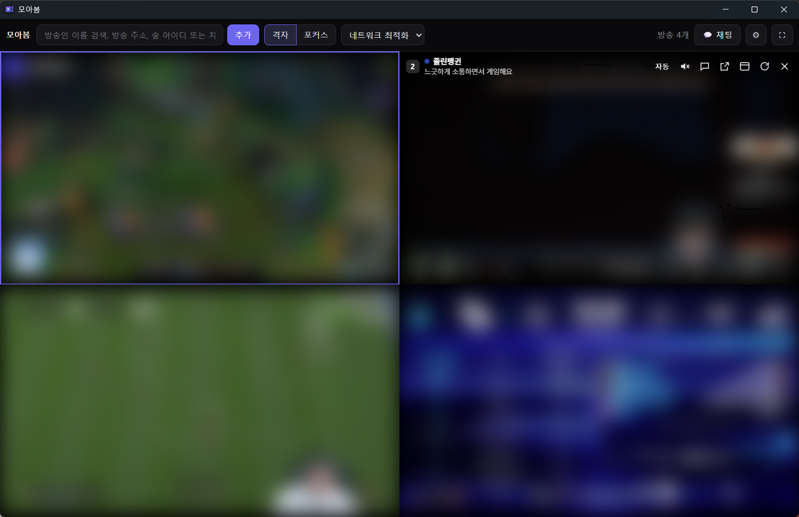
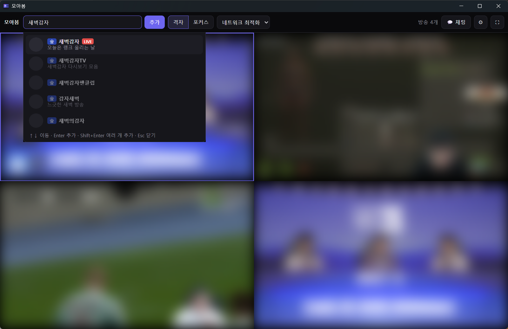
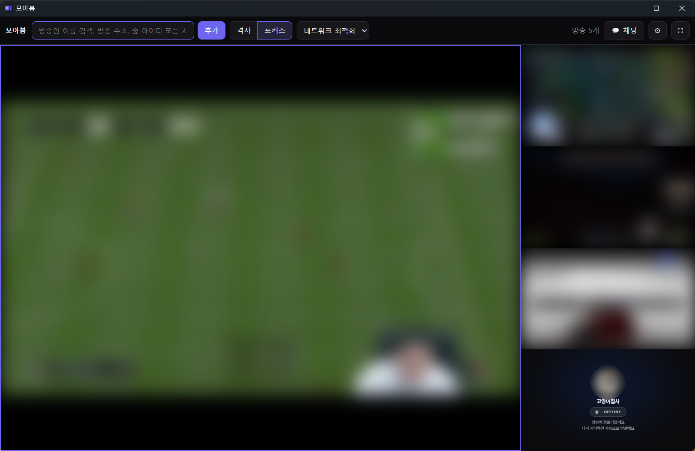

<div align="center">


# 모아봄 (Moabom)

**여러 라이브 방송을 한 화면에 모아 보는 Windows 멀티뷰 프로그램**

숲(SOOP) · 치지직(CHZZK) · 씨미(CIME) · 유튜브(YouTube) · 트위치(Twitch) · 킥(Kick)

[**⬇ 최신 버전 다운로드**](../../releases/latest) · [**💜 후원하기**](https://fairy.hada.io/@moabom)

<br>



</div>

---

## 멀티뷰가 뭔가요?

**멀티뷰**는 여러 방송을 한 화면에 나눠 동시에 보는 것을 말해요.
모아봄은 숲·치지직·유튜브 등 플랫폼이 달라도 한 창에서 멀티뷰로 볼 수 있게 해 줘요.
브라우저 창을 여러 개 띄워 이리저리 맞출 필요가 없어요.

## 이런 걸 할 수 있어요

- 📺 **플랫폼 상관없이 멀티뷰** — 플랫폼이 달라도 한 창에 격자로 나란히 띄워요.
- 🔍 **이름으로 검색해서 추가** — 방송인 이름을 치거나 방송 주소를 붙여 넣으면 끝.
- 🔊 **소리는 하나만** — 보고 싶은 방송을 고르면 그 방송 소리만 나와요.
- 🔎 **크게 보기** — 한 방송을 크게 키우고 나머지는 작게 볼 수 있어요.
- 💬 **채팅 같이 보기** — 고른 방송의 채팅을 오른쪽에 띄워요.
- 🎚 **화질 한 번에 조절** — 모든 방송을 최고 화질 / 자동 / 저화질로 한 번에 바꿔요.
- ⚡ **가볍고 쾌적한 시청** — 방송 화면 외의 불필요한 요소를 정리해 여러 방송도 가볍게 돌아가요.
- 🔁 **멈추면 알아서 복구** — 영상이 멈추면 다시 재생하거나 새로고침해요.
- 💤 **방송 종료 표시** — 꺼진 방송은 깔끔한 종료 화면으로 바뀌고, 다시 켜지면 자동으로 연결해요.
- ↔ **끌어서 자리 바꾸기** — 방송 위 번호·이름을 잡고 다른 칸에 놓으면 자리가 바뀌어요.
- 🟢 **치지직 1080p** — 별도 확장 프로그램 없이 고화질로 볼 수 있어요.
- 🔵 **숲 4개 이상** — 숲 방송을 4개 넘게 동시에 볼 수 있어요.

| 검색해서 바로 추가 | 크게 보기 · 방송 종료 표시 |
|---|---|
|  |  |

> 스크린샷 속 방송 화면은 흐리게 처리했고, 방송인 이름과 방송 제목은 예시로 바꿨어요.

## 설치 방법

[**릴리스 페이지**](../../releases/latest)에서 두 가지 중 편한 걸 받으세요.

| 파일 | 이런 분께 |
|---|---|
| `..._x64-setup.exe` (설치판) | 시작 메뉴·바탕화면에서 바로 실행하고 싶을 때 |
| `..._x64-portable.zip` (포터블) | 설치 없이 바로 써 보고 싶을 때, USB에 넣어 다닐 때 |

**설치판**
1. `..._x64-setup.exe`를 받아 실행해서 설치해요.
2. 바탕화면이나 시작 메뉴에서 **모아봄**을 실행하면 끝!

**포터블**
1. `..._x64-portable.zip`을 받아 원하는 폴더에 압축을 풀어요.
2. 폴더 안의 **Moabom.exe**를 실행하면 끝! (`extensions` 폴더는 지우지 마세요)

> **"Windows의 PC 보호" 파란 창이 뜨면?**
> 개인이 만든 프로그램이라 처음 실행할 때 이 경고가 나올 수 있어요.
> **추가 정보** → **실행**을 누르면 돼요.

> Windows 10 / 11에서 동작해요. 실행에 필요한 WebView2가 없으면 설치판은 설치 중에 자동으로 받아요.
> 포터블은 WebView2가 이미 있어야 해요 (Windows 11과 대부분의 Windows 10에는 기본으로 들어 있어요).

## 사용법

1. 위쪽 검색창에 **방송인 이름**이나 **방송 주소**를 입력하고 **추가**를 눌러요.
2. 방송 위에 마우스를 올리면 제목과 조작 버튼이 나타나요.
3. 숫자키(<kbd>1</kbd>~<kbd>9</kbd>)로 방송을 고르면 그 방송 소리가 켜져요.

검색창에는 이런 것도 넣을 수 있어요.

| 입력 예시 | 뜻 |
|---|---|
| `방송인 이름` | 이름으로 검색 |
| `https://chzzk.naver.com/live/...` | 방송 주소 그대로 |
| `devil0108` | 숲 방송국 아이디 |
| `0dad8baf12a436f722faa8e5001c5011` | 치지직 채널 ID (32자리) |
| `twitch:이름` · `kick:이름` | 트위치·킥 채널을 바로 지정 |

## 단축키

<kbd>?</kbd> 또는 <kbd>F1</kbd>을 누르면 프로그램 안에서도 볼 수 있어요.

| 키 | 하는 일 |
|---|---|
| <kbd>1</kbd> ~ <kbd>9</kbd> | 방송 선택 (소리 켜기) |
| <kbd>Tab</kbd> / <kbd>Shift</kbd>+<kbd>Tab</kbd> | 다음 / 이전 방송 선택 |
| <kbd>M</kbd> | 음소거 켜기·끄기 |
| <kbd>Q</kbd> | 화질 바꾸기 (최고 → 자동 → 저화질) |
| <kbd>F</kbd> | 선택한 방송 크게 보기 ↔ 격자 |
| <kbd>F11</kbd> | 전체 화면 |
| <kbd>C</kbd> | 채팅 |
| <kbd>D</kbd> | 창 분리 / 합치기 |
| <kbd>V</kbd> | 사이트 보기 ↔ 영상만 보기 |
| <kbd>R</kbd> | 새로고침 |
| <kbd>Alt</kbd>+<kbd>←</kbd> / <kbd>→</kbd> | 방송 순서 옮기기 |
| <kbd>Delete</kbd> | 방송 닫기 |
| <kbd>N</kbd> / <kbd>Ctrl</kbd>+<kbd>L</kbd> | 방송 추가 |

## 자주 묻는 질문

<details>
<summary><b>방송이 검은 화면에서 안 움직여요.</b></summary>

방송 위에서 <kbd>R</kbd>을 눌러 새로고침해 보세요. 방송이 끝났으면 계속 검은 화면으로 남아요.
</details>

<details>
<summary><b>컴퓨터가 버벅여요.</b></summary>

방송 여러 개를 한꺼번에 최고 화질로 틀면 무거워요. 위쪽 화질 버튼에서 **자동**이나 **저화질**로 바꿔 보세요.
</details>

## 후원하기

모아봄이 마음에 드셨다면 [**Fairy에서 후원**](https://fairy.hada.io/@moabom)해 주세요. 계속 고치고 다듬는 데 큰 힘이 돼요. 🙏

## 문제가 생겼어요 / 제안할 게 있어요

편한 방법으로 알려 주세요.

- **GitHub 계정이 있다면** → [**이슈 남기기**](../../issues/new/choose)에서 "오류 제보"나 "기능 제안"을 골라 칸을 채워 주세요.
- **계정이 없다면** → 앱의 설정(⚙) 창 아래 **오류 제보** 버튼을 누르거나, **gitter0001@gmail.com** 으로 메일을 보내 주세요.

아래 내용을 함께 알려 주시면 원인을 훨씬 빨리 찾을 수 있어요.

1. 모아봄 버전 (설정 창 아래에 나와 있어요)
2. 어떤 플랫폼의 어떤 방송이었는지 (예: 치지직 OOO)
3. 무엇을 했더니 어떻게 됐는지
4. 가능하면 스크린샷

---

<details>
<summary><b>개발자용: 직접 빌드하기</b></summary>

### 필요한 것

- [Rust](https://rustup.rs/) (stable)
- Tauri CLI 2: `cargo install tauri-cli --version "^2"`
- WebView2 런타임 (Windows 11에는 기본 설치)

### 실행·빌드

```sh
cd src-tauri
cargo tauri dev      # 개발 실행
cargo tauri build    # 설치 파일 생성 (target/release/bundle/nsis/)
```

### 폴더 구조

```
.
├── ui/                    # 위쪽 컨트롤 바 화면 (index.html)
├── src-tauri/             # Tauri(Rust) 앱
│   ├── src/               # Rust 소스
│   │   └── inject/        # 방송 화면에 넣는 스크립트
│   ├── extensions/        # 방송 화면에 불러오는 브라우저 확장 (제3자)
│   ├── capabilities/      # Tauri 권한 설정
│   ├── icons/
│   ├── Cargo.toml
│   └── tauri.conf.json
├── docs/screenshots/      # README 스크린샷
├── .github/workflows/     # 자동 빌드·릴리스
└── THIRD_PARTY.md         # 제3자 구성요소와 라이선스
```

### 릴리스 내기

`v`로 시작하는 태그를 올리면 GitHub Actions가 설치 파일을 빌드해 릴리스에 올려요.
버전 번호는 태그에서 가져오니 `tauri.conf.json`을 따로 고치지 않아도 돼요.

```sh
git tag v0.1.0
git push origin v0.1.0
```

</details>

## 라이선스

모아봄의 코드는 [PolyForm Strict 1.0.0](LICENSE) 라이선스를 따릅니다.

- ✅ 개인적·비상업적 용도로 자유롭게 설치하고 사용할 수 있어요.
- ❌ 코드를 수정하거나, 수정한 버전·원본을 다시 배포할 수 없어요.
- ❌ 상업적 용도로 사용할 수 없어요.

uBlock Origin Lite 등 제3자 구성요소는 각자의 라이선스를 따릅니다. 자세한 내용은 [THIRD_PARTY.md](THIRD_PARTY.md)를 보세요.
